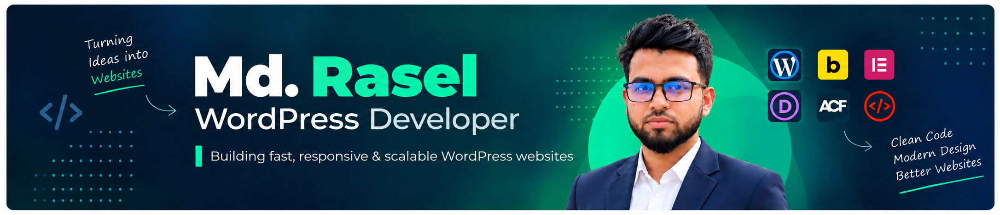

  

  
  
  
  
  
  

  

<!--

  

-->

## 👨‍💻 ABOUT ME

I'm **Md. Rasel**, a WordPress Developer with **2+ years of professional experience**, passionate about building modern, high-performance websites that combine thoughtful design with reliable functionality.

I specialize in **Custom WordPress Theme Development, Bricks Builder, and Advanced Custom Fields (ACF)**. With a strong foundation in `HTML`, `CSS`, `JavaScript`, and `PHP`, I turn design concepts into responsive, dynamic, and easy-to-manage WordPress websites for businesses and agencies.

---

### **🛠️ My Core Expertise**

- 🧩 Custom WordPress Theme Development
- 🏗️ Bricks Builder Website Development
- 🔧 Dynamic Content & Custom Fields with ACF
- 🎨 Figma to WordPress Conversion
- 💻 Frontend Development with HTML, CSS & JavaScript
- 📱 Responsive & Pixel-Perfect Web Design
- ⚡ Website Performance Optimization
- 🔍 SEO-Friendly Website Structure
- 🛠️ Custom Functionality & WordPress Customization
- 💡 Clean, Maintainable & Scalable Code

---

### 🤝 Let's Work Together

  
  I'm open to WordPress projects, freelance opportunities, and collaboration.

---

## 🛠️ TECH STACK & TOOLS

### Languages & Development

        

### WordPress & Page Builders

    

### Design & Optimization

    

---

## 💼 PROFESSIONAL EXPERIENCE

### Junior Web Developer — Full-time

**Fabiolabs** · April 2026 – Present

Developing and maintaining WordPress websites and custom web solutions, with a strong focus on payment system integration, troubleshooting, bug fixing, and improving website functionality. Working with PHP and modern frontend technologies to deliver reliable, responsive, and user-friendly web experiences.

**📍 Key Contributions:**

- Integrated and configured payment systems for WordPress websites
- Identified and fixed website bugs and functionality issues
- Developed and customized WordPress website features
- Implemented booking systems and related functionality
- Built dynamic content solutions using ACF
- Developed and customized layouts with Bricks Builder and Elementor
- Improved website responsiveness, performance, and usability
- Troubleshot frontend and backend issues using PHP, JavaScript, and CSS
---

### Junior Web Developer — Part-Time

**ALOKIO** · February 2025 – March 2026 (1 yr 1 mo)

At ALOKIO, I built and maintained high-quality WordPress websites and custom web solutions using PHP and modern frontend technologies. My work included custom theme development, scalable functionality, website performance optimization, and responsive, user-focused design. I collaborated with the team to deliver reliable solutions that supported business goals.

**📍 Key Contributions:**

- Developed and maintained custom WordPress websites
- Built custom themes and reusable website components
- Implemented dynamic content systems using ACF
- Developed reusable sections and layouts with Bricks Builder
- Created responsive, pixel-perfect, and cross-browser layouts
- Implemented custom functionality using PHP and JavaScript
- Optimized website performance, usability, and SEO structure
- Collaborated with the team on real-world client projects

---

### WordPress Web Development Intern

**ALOKIO** · October 2024 – January 2025 (4 mos)

During my internship at ALOKIO, I assisted in developing and maintaining WordPress websites, working with custom themes, PHP-based functionality, and popular page builders. I supported the team with front-end tasks, bug fixes, performance improvements, and website updates. This role helped me strengthen my skills in WordPress, PHP, and responsive design while gaining real-world development experience.

**📍 Key Contributions:**

- Developed responsive WordPress websites
- Created reusable website sections and layouts
- Implemented dynamic content using ACF
- Worked with Elementor, Divi, and Bricks Builder
- Converted design concepts into functional websites
- Fixed responsive design and frontend issues
- Worked with PHP, JavaScript, and CSS
- Assisted with website optimization and maintenance

---
## 📌 FEATURED PROJECTS
*Adding more projects soon!*

---

## 📚 CURRENTLY LEARNING

**Learning today. Building better tomorrow.**

  
  
  
  
  

**Exploring advanced WordPress development, custom plugin creation, AI integration and website automation.**

---
## 📊 GITHUB INSIGHTS

### Code, consistency & continuous growth.

  
  

## ☎️ LET'S CONNECT
### Let's create something meaningful together.

I'm open to collaborating on exciting web projects, exploring innovative ideas, and building impactful digital experiences.

  
  
  
  

